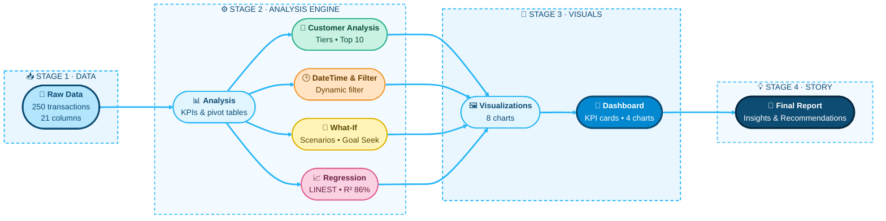

# DATA-INTELLIGENCE-DASHBOARD
<!-- ✦ Data Intelligence Dashboard • README ✦ -->

<div align="center">


<a href="https://git.io/typing-svg"></a>

<br/>


<br/>


<br/><br/>

> ### ✧･ﾟ: *✧･ﾟ:*  💭 *Thought of the Day*  *:･ﾟ✧*:･ﾟ✧
> **“Without data, you’re just another person with an opinion.”**
> — W. Edwards Deming

</div>

<br/>

<div align="center">

### ✦ ･ ﾟ: *✧･ﾟ:*  Quick Navigation  *:･ﾟ✧*:･ﾟ ✦

| [🌸 About](#about) | [🎯 Objectives](#objectives) | [📂 Dataset](#dataset) | [🧱 Structure](#structure) |
|:-:|:-:|:-:|:-:|
| [📑 Sheets](#sheets) | [💎 Insights](#insights) | [🛠️ Skills](#skills) | [🚀 How to Use](#howto) |

</div>

<p align="center">✦ ･ ﾟ: *✧･ﾟ:* ─────── ❀ ─────── *:･ﾟ✧*:･ﾟ ✦</p>

<a id="about"></a>


**Data Intelligence Dashboard** is a complete, end-to-end **Excel data analytics project**. A sales-transactions dataset (250 rows) is cleaned, analysed and visualised — all with **live formulas**, so the moment the data changes, every table, chart and report updates by itself. ✨

The project covers all of this in a single workbook:

- 📊 **KPI summary** and pivot-style analysis tables (SUMIFS / COUNTIFS / SUMPRODUCT)
- 👥 **Customer analysis** — value tiers, top customers, list comparison
- 🕒 **Date & time functions**, dynamic filter and auto-timestamp
- 🎯 **What-If analysis** — Best / Base / Worst scenarios + Goal Seek
- 📈 **Regression** — ToolPak-style output built with LINEST
- 🎨 **13 charts** + interactive **dashboard** + storytelling **report**


 

<p align="center">✦ ･ ﾟ: *✧･ﾟ:* ─────── ❀ ─────── *:･ﾟ✧*:･ﾟ ✦</p>


<div align="center">

| 🌸 **Live Formulas** | 🎨 **13 Charts** | 🧭 **Smart Dashboard** |
|:-:|:-:|:-:|
| 3000+ formulas update everything automatically | Bar • Line • Pie • Scatter with trendline | KPI cards, indicators & Top-5 tables on one screen |
| 🔽 **Dynamic Filter** | 🎯 **What-If + Goal Seek** | 📈 **Regression** |
| Pick a region from the dropdown and matching rows appear automatically | Best / Base / Worst scenarios & target solving | Full ToolPak-style output using LINEST |

</div>

### 🔄 Project Workflow



<p align="center">✦ ･ ﾟ: *✧･ﾟ:* ─────── ❀ ─────── *:･ﾟ✧*:･ﾟ ✦</p>

<a id="objectives"></a>


| ✦ | Objective |
|:-:|:--|
| 1 | Clean and structure the raw sales data so it is analysis-ready |
| 2 | Understand performance by region, category, product, payment method and segment |
| 3 | Identify high-value customers and divide customers into tiers |
| 4 | Track time-based trends and month-over-month growth |
| 5 | Estimate future revenue and profit using Best / Base / Worst scenarios |
| 6 | Show all KPIs and charts on a single dashboard |
| 7 | Draw **insights and recommendations** from the data |

<p align="center">✦ ･ ﾟ: *✧･ﾟ:* ─────── ❀ ─────── *:･ﾟ✧*:･ﾟ ✦</p>

<a id="dataset"></a>


<div align="center">

| 📅 Period | 🧾 Transactions | 👥 Customers | 📦 Products | 🌍 Regions |
|:-:|:-:|:-:|:-:|:-:|
| 11 Apr 2024 – 11 Apr 2025 | 250 | 50 | 10 | 5 |

</div>

### 🗂️ Raw Data — Columns

| Column | Description |
|:--|:--|
| `Transaction_ID` | Unique ID of each transaction |
| `Date` | Date of the transaction |
| `Customer_ID`, `Customer_Name` | Customer identification |
| `Product_ID`, `Product_Name`, `Category` | Product details (Electronics / Furniture / Appliances) |
| `Quantity`, `Unit_Price` | Units sold and price per unit |
| `Payment_Method` | Cash / Credit Card / Debit Card / PayPal |
| `Region` | Central / East / North / South / West |
| `Customer_Segment` | Basic / Standard / Premium |
| `Customer_Since` | Date the customer joined |
| `Total_Amount` | Quantity × Unit_Price |

**⚙️ Helper columns (formulas):** `Month_Start`, `Month_End`, `Tenure_Yrs`, `Days_Since_Purchase`, `Name_Count`, `Purchase_Type` (First / Repeat), `Filter_Seq`

<!-- 📸 Add your Dashboard screenshot here (upload it to the repo as images/dashboard.png):

-->

<p align="center">✦ ･ ﾟ: *✧･ﾟ:* ─────── ❀ ─────── *:･ﾟ✧*:･ﾟ ✦</p>

<a id="structure"></a>


```text
📘 Final_Project1.xlsx
 │
 ├── 📄 Raw Data          → 250 transactions + helper formula columns
 ├── 📊 Analysis          → KPI & pivot-style summary tables
 ├── 👥 Customer Analysis → GroupBy, tiers, top 10, list comparison
 ├── 🕒 DateTime_Filter   → Date functions, dynamic filter, timestamp
 ├── 🎯 What-If           → Scenario summary + Goal Seek
 ├── 📈 Regression        → LINEST-based regression output
 ├── 🎨 Visualizations    → 8 charts (bar, line, pie)
 ├── 🧭 Dashboard         → KPI cards, indicators, top-5 tables, 4 charts
 └── 📝 Report            → Insights, storytelling & recommendations
```

<p align="center">✦ ･ ﾟ: *✧･ﾟ:* ─────── ❀ ─────── *:･ﾟ✧*:･ﾟ ✦</p>

<a id="sheets"></a>


<details>
<summary><b>📊 1. Analysis</b> — formula-based summary tables</summary>
<br/>

- **KPI Summary:** Total Revenue, Transactions, Units Sold, Average Order Value, Unique Customers, Revenue per Customer
- **Sales by Region** — revenue, orders, units, % share, AOV, performance index
- **Sales by Category** and **Sales by Product** (with rank & abbreviation code)
- **Monthly Sales Trend** with MoM % change and month labels
- **Sales by Payment Method** and **Customer Segment**
- **Repeat vs First-time** purchases, most-sold / highest-revenue product
- **Top 5 Most Sold Products**

</details>

<details>
<summary><b>👥 2. Customer Analysis</b> — know your customers</summary>
<br/>

- Customer-wise **orders, units, revenue, AOV** and **revenue rank**
- **Value Tiers** — High / Mid / Low (percentile threshold is an input cell)
- Customer **initials** and auto-generated **customer code**
- **Top 10 customers** and tier-wise revenue summary
- **Compare Two Lists** — Electronics buyers vs Furniture buyers (matching names extracted)

</details>

<details>
<summary><b>🕒 3. DateTime_Filter</b> — time functions & dynamic filter</summary>
<br/>

- Practical use of `TODAY`, `NOW`, `DATEDIF` and `EOMONTH`
- **Dynamic filter:** choose a Region (dropdown) and a minimum amount, and the matching rows appear automatically
- **Auto-timestamp:** as soon as an entry is typed, the `NOW()` time freezes (using iterative calculation)

</details>

<details>
<summary><b>🎯 4. What-If</b> — scenarios & Goal Seek</summary>
<br/>

- Base / Best / Worst scenarios (price change, volume change, discount)
- The scenario dropdown (1 / 2 / 3) switches the **Selected** column
- Projected Revenue, Cost, **Profit**, Profit Margin and comparison with Base
- **Goal Seek:** how much volume change is needed to reach a target revenue growth

</details>

<details>
<summary><b>📈 5. Regression</b> — ToolPak-style output</summary>
<br/>

- `Y = Total_Amount`, `X1 = Quantity`, `X2 = Unit_Price`
- Multiple R, R², Adjusted R², Standard Error, ANOVA, Coefficients, t-Stat, P-value, 95% limits
- **Prediction** from the fitted equation + scatter chart with trendline

</details>

<details>
<summary><b>🎨 6. Visualizations & 🧭 7. Dashboard</b></summary>
<br/>

**Charts:** Revenue by Region • Revenue Share by Category • Monthly Revenue Trend • Top 10 Customers • Units Sold by Product • Revenue Share by Payment Method • Revenue by Customer Segment • Orders by Region

**Dashboard:** 5 KPI cards, last-month vs previous-month indicators (with direction icons), regional pivot-style table, Top 5 customers, Top 5 products and 4 charts — all on a single screen.

</details>

<details>
<summary><b>📝 8. Report</b> — insights & storytelling</summary>
<br/>

Summary insights, top customers, most-sold products, regional sales, and a 10-point **data story** (Overview → Regions → Categories → Products → Customers → Time trend → Payments → Loyalty → Regression → What-If) with final **recommendations**.

</details>

<p align="center">✦ ･ ﾟ: *✧･ﾟ:* ─────── ❀ ─────── *:･ﾟ✧*:･ﾟ ✦</p>

<a id="insights"></a>


<div align="center">

| 💰 Total Revenue | 🧾 Transactions | 📦 Units Sold | 🛒 Avg Order Value | 👥 Customers |
|:-:|:-:|:-:|:-:|:-:|
| **229,192** | **250** | **753** | **916.77** | **50** |

</div>

- 🌍 **East** is the strongest region (~59.3K revenue, ≈26%), followed by **North** (~50.8K); **South** is the lowest (~36.4K).
- 💻 **Electronics** alone brings in ≈ **75%** of revenue; **Appliances** contribute only ≈ 4%.
- 🏆 **Laptop** and **Smartphone** are almost tied as the top revenue products (~67K each); by units, **Bookshelf** leads (102 units).
- 👑 The top customer is **Mark Carter** (~15.7K), followed by Edward Mitchell and Barbara Young.
- 💎 Just **10 High-Value customers** bring in ≈ **41%** of total revenue.
- 🔁 **80%** of transactions are repeat purchases.
- 💳 Revenue is fairly balanced across payment methods — **Credit Card** is slightly ahead (≈27%).
- ⭐ **Premium** and **Standard** segments together make up ≈ 73% of revenue.
- 📅 The best month was **Jan-25** (~25.8K).
- 📈 According to the regression, **Quantity** and **Unit_Price** together explain ≈ **86%** of the variation in order value.

> 📌 *Numbers are based on the current snapshot of the dataset; everything in the workbook updates through live formulas.*

<p align="center">✦ ･ ﾟ: *✧･ﾟ:* ─────── ❀ ─────── *:･ﾟ✧*:･ﾟ ✦</p>


<div align="center">

<table>
<tr>
<td align="center"></td>
<td align="center"></td>
</tr>
<tr>
<td align="center" colspan="2"></td>
</tr>
</table>

</div>

### 🏅 Top Products by Revenue

| # | Product | Revenue | Bar |
|:-:|:--|--:|:--|
| 🥇 | Laptop | 67,499 | 🟦🟦🟦🟦🟦🟦🟦🟦🟦🟦🟦🟦🟦🟦🟦🟦🟦🟦🟦🟦 |
| 🥈 | Smartphone | 67,199 | 🟦🟦🟦🟦🟦🟦🟦🟦🟦🟦🟦🟦🟦🟦🟦🟦🟦🟦🟦⬜ |
| 🥉 | Desk | 23,399 | 🟦🟦🟦🟦🟦🟦🟦⬜⬜⬜⬜⬜⬜⬜⬜⬜⬜⬜⬜⬜ |
| 4 | Monitor | 21,999 | 🟦🟦🟦🟦🟦🟦🟦⬜⬜⬜⬜⬜⬜⬜⬜⬜⬜⬜⬜⬜ |
| 5 | Bookshelf | 15,299 | 🟦🟦🟦🟦🟦⬜⬜⬜⬜⬜⬜⬜⬜⬜⬜⬜⬜⬜⬜⬜ |

### 💳 Payment & Segment Split

| 💳 Payment Method | Revenue | 👑 Segment | Revenue |
|:--|--:|:--|--:|
| Credit Card | 61,448 | Premium | 84,657 |
| PayPal | 58,198 | Standard | 82,358 |
| Cash | 57,428 | Basic | 62,178 |
| Debit Card | 52,118 | | |

### 🎯 What-If Snapshot

| Scenario | Price | Volume | Discount | Revenue | Profit |
|:--|:-:|:-:|:-:|--:|--:|
| 🔵 Base | 0% | 0% | 0% | 229,192 | 68,758 |
| 🌟 Best | +5% | +10% | 2% | 259,423 | 82,945 |
| 🌧️ Worst | −3% | −10% | 8% | 184,078 | 39,687 |

> 🎯 **Goal Seek:** to reach **+15% revenue** over Base, a ≈ **11.8% volume growth** is needed.

<p align="center">✦ ･ ﾟ: *✧･ﾟ:* ─────── ❀ ─────── *:･ﾟ✧*:･ﾟ ✦</p>

<a id="skills"></a>


| 🧩 Category | ✨ Functions / Features |
|:--|:--|
| **Aggregation** | `SUM` `SUMIFS` `COUNTIFS` `SUMPRODUCT` `AVERAGE` `MEDIAN` `PERCENTILE` `MIN` `MAX` |
| **Lookup** | `INDEX` `MATCH` `CHOOSE` |
| **Date & Time** | `TODAY` `NOW` `DATEDIF` `EOMONTH` `EDATE` |
| **Text** | `UPPER` `LEFT` `MID` `FIND` `TEXT` `RIGHT` `VALUE` |
| **Logic** | `IF` `AND` `IFERROR` `RANK` |
| **Statistics** | `LINEST` `FDIST` `TDIST` `TINV` `SQRT` |
| **Features** | Data Validation (dropdowns) • Conditional Formatting (icon sets, data bars) • Scenario & Goal Seek • Iterative Calculation • Charts (Bar / Line / Pie / Scatter) |

<p align="center">✦ ･ ﾟ: *✧･ﾟ:* ─────── ❀ ─────── *:･ﾟ✧*:･ﾟ ✦</p>

<a id="howto"></a>


1. 📥 **Download** `Final_Project1.xlsx` and open it in **Microsoft Excel**.
2. 🧭 Start with the **Dashboard** sheet — the full summary is there.
3. 🔽 In **DateTime_Filter**, change the Region dropdown and the minimum amount to try the dynamic filter.
4. 🎯 In **What-If**, change the scenario number (1 / 2 / 3) to see projected revenue & profit.
5. 📝 Finally, read the **Report** sheet — the insights and recommendations are there.

### ⚠️ Important Notes

- 🔁 For the **auto-timestamp**, turn ON `File → Options → Formulas → Enable iterative calculation`.
- 📅 `TODAY()` / `NOW()` are volatile, so columns like *Days Since Purchase* will change every day.
- 📉 **Apr 2025** is a *partial month* (data only goes up to 11 Apr 2025), so be careful with MoM comparisons.
- 📐 In this data `Total_Amount = Quantity × Unit_Price`, so a straight-line regression model is only an approximation.
- 💡 The *cost %* (70%) in What-If is an **assumption**, as the dataset has no cost data.

<p align="center">✦ ･ ﾟ: *✧･ﾟ:* ─────── ❀ ─────── *:･ﾟ✧*:･ﾟ ✦</p>


**💡 Recommendations**
- Focus marketing on High-Value customers and the top region (East).
- Bundle slow-moving **Appliances** with high-selling Electronics in offers.
- Run targeted offers for the weakest region (South).
- Promote the preferred payment options at checkout.
- Offer loyalty or segment-based deals to increase repeat purchases.
- Use the Dashboard's MoM arrows to spot monthly slowdowns early.

**🚀 Future Scope**
- Add real **Slicers** and a **Timeline**
- Handle larger datasets with Power Query / Power Pivot
- Add forecasting (trend / seasonality)
- Build a Power BI dashboard version

<br/>

<div align="center">


<br/><br/>

> ### ✧･ﾟ: *✧･ﾟ:*  💭 *Closing Thought*  *:･ﾟ✧*:･ﾟ✧
> **“Data is the new canvas — and every chart is a little piece of art.”** 🎨

<a href="https://git.io/typing-svg"></a>

<br/>

### ✍️ Author — **Bhavika Thadani**


</div>
